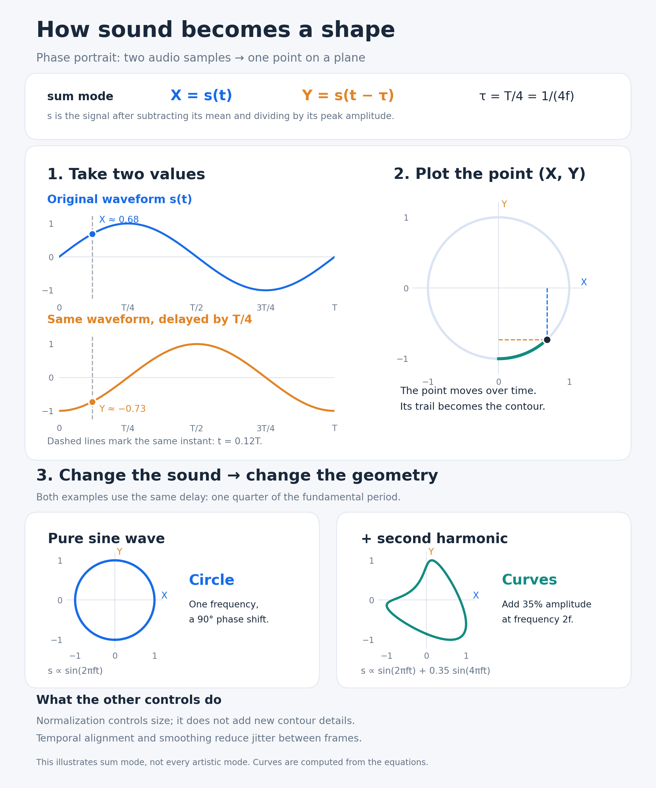

# TimbreForm

Audio Visualizer

TimbreForm is a real-time audio visualizer that turns sound into evolving geometry. Explore timbre through phase portraits, spatial shapes, fractals and image morphing, with live audio input and customizable visuals. Audio analysis and rendering run locally in your browser; no account or backend is required.

## How sound becomes a shape



In **Sum** mode, TimbreForm plots the centered, peak-normalized mono waveform as X = s(t) and a delayed copy as Y = s(t − τ). The delay is approximately one quarter of the detected fundamental period: τ = 1/(4f). A pure sine wave produces a circle; adding harmonics changes the contour, making timbre visible. The diagram illustrates Sum mode; note layers and spatial, fractal and image effects add their own visual interpretations.

## Run (Docker only)

```sh
docker compose up -d --build app
```

Open http://127.0.0.1:8093 (localhost secure context permits browser audio input).

```sh
docker compose run --rm --build test
docker compose run --rm test npm run typecheck
docker compose build app
```

Compose project: `phase-visualizer`. Only `127.0.0.1:8093` is published.

## Features

- Input device selection and reconnect, start/stop, input meter, clean DI / microphone profiles, stable / responsive detection, polyphony, sensitivity, gain and three synthesized demos.
- Sum / note / hybrid signal layers; classic and spatial presets with independent controls and reset.
- Lines, cage and surface; automatic, high and economy scene quality.
- Detail, smoothing speed, width, blur, glow, opacity, brightness, trails; spatial depth, tilt, rotation, bend, axis diversity and layer movement / sound response.
- Fractal background, morph transition time, brightness, zoom, travel direction, speed, audio response, morph, detail motion, density and symmetry.
- Up to sixteen local images, thumbnails, removal, clear, enable, beat/energy/time modes and all image morph controls. Images stay in browser memory and are released on removal/unmount.
- Fullscreen and idle auto-hide toolbar, including settings and exit controls.

The visualizer uses the live waveform and detected note layers. Note names appear in the colored layer legend. Settings and uploaded images last for the current browser session; uploaded images stay on your device.

## Project

Repository: https://github.com/saros-128/TimbreForm. No license has been selected or added.

## Accuracy and verification limits

The mono phase trace is a measured waveform against a delayed copy. Colored note layers are approximate spectral projections; spatial geometry, fractal and image movement are visual interpretations. They do not recover separate physical strings. Real microphone/audio-interface access and visual latency require a hardware check in the user's browser. Automated tests and synthesized demos cannot certify that rig.

## Validation

- 140 tests in 21 suites passed in Docker, including standalone input wiring, source/geometry switching and independent preset controls.
- TypeScript check and production Docker build passed.
- Browser smoke check in Brave: Cmaj7 demo produced four colored layers; spatial surface, fractal, settings and fullscreen enter/exit worked. Demo was stopped afterwards. Physical input permission/access and uploaded-image file picker were not exercised; image rendering has retained regression coverage.
- Updated only the transitive source-map-js lock entry to 1.2.2; npm audit reported zero vulnerabilities after installation.
